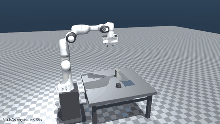
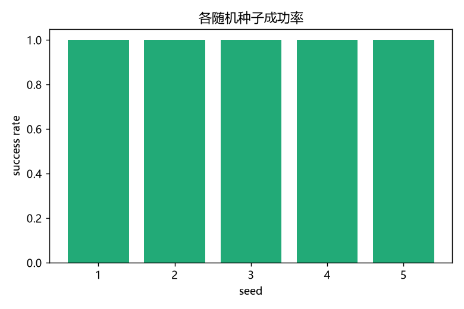
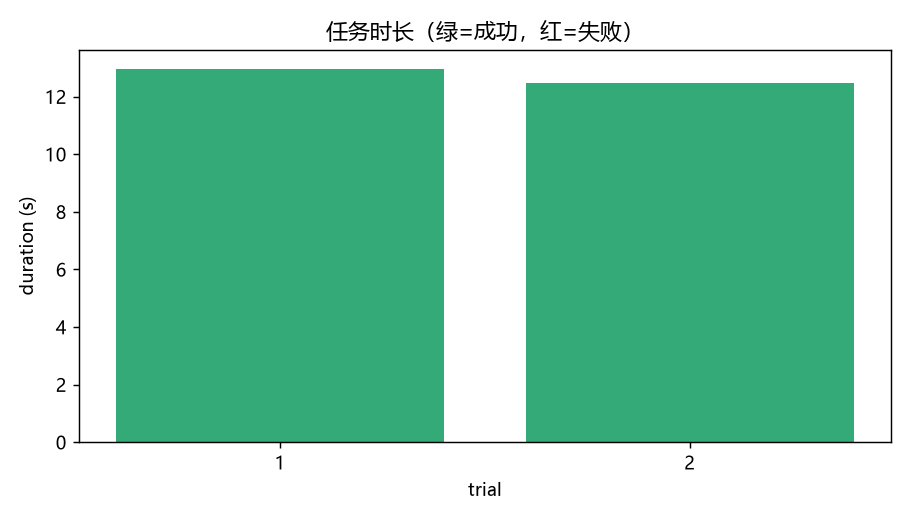
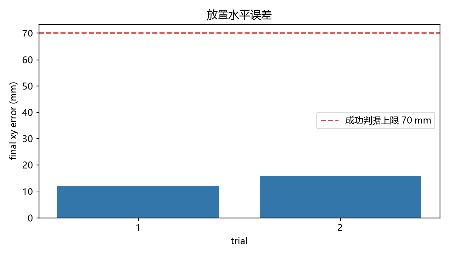

# 具身智能机器人仿真平台（MuJoCo · Franka Panda）

在 Windows 上可**真实运行**的具身智能实验平台：Franka Panda 完成「抓取 → 搬运 → 放置」，
链路包含多模态感知（RGB / 深度 / 语义分割 / 本体感知 / 仿真接触力）、动态场景图、
中文指令规则解析、符号任务规划、技能执行与失败恢复、以及批量实验评价。

> 关键原则：**动作全部由 MuJoCo 执行器 + `mj_step` 产生**。
> 不改物体坐标、不 teleport、不焊接、不播放预录动画；失败如实记录原因，不伪造成功。



*GIF 由 `scripts/record_gif.py` 在 `mj_step` 循环中逐帧抓取真实仿真画面生成（440×248，143 帧，10 fps）。*

---

## 1. 一键运行（双击即可）

| 文件 | 作用 | 说明 |
| --- | --- | --- |
| `run_simulation.cmd` | **打开可视化窗口**，实时演示抓取-放置 | 使用 MuJoCo 官方被动查看器，画面与物理同步 |
| `run_experiment.cmd` | 批量实验（5 个随机种子 × 2 次） | 生成 CSV / JSONL / 图表，无窗口 |
| `run_tests.cmd` | 自动化测试 | pytest，15 项，约 10 秒 |
| `README.html` | **推荐阅读的图文版说明** | 双击用浏览器打开，直接内嵌 GIF 与截图 |

命令行等价形式（PowerShell）：

```powershell
cd <项目根目录>          # 例如 G:\embodied_ai_sim_platform
$env:PYTHONIOENCODING="utf-8"
.\.venv\Scripts\python.exe .\scripts\viewer_demo.py
```

---

## 2. 环境

| 项 | 值 |
| --- | --- |
| 操作系统 | Windows 11 (26200) |
| Python | 3.11.9，独立虚拟环境 `<项目根目录>\.venv` |
| 物理引擎 | **MuJoCo 3.2.2**（锁定版本，原因见 §9） |
| 依赖 | numpy 2.4.6 / scipy 1.17.1 / opencv-python 5.0.0 / matplotlib 3.11.2 / Pillow / pytest |
| 机型 | i5-13490F / 15.8 GB RAM / GTX 1050 Ti 4 GB |
| 机器人模型 | MuJoCo Menagerie `franka_emika_panda`（原文件未修改，36.5 MB，逐文件 SHA1 校验） |

重建虚拟环境：

```powershell
cd <项目根目录>
py -3.11 -m venv .venv
.\.venv\Scripts\python.exe -m pip install -r requirements.txt
```

依赖版本锁定在 `requirements.txt`（MuJoCo 3.2.2 等），与下表一致。

---

## 3. 目录结构

```
embodied_ai_sim_platform/
├─ run_simulation.cmd / run_experiment.cmd / run_tests.cmd   一键入口
├─ README.md / README.html                                   说明文档（HTML 可双击打开）
├─ config/objects.json                    物体语义表（类别 / 角色 / 是否可抓取）
├─ assets/mujoco_menagerie/…              官方 Panda 模型（只读，未修改）
├─ scenes/
│  ├─ main_scene.xml                      主场景（台面、红方块、蓝目标区、黄障碍、3 相机、keyframe）
│  └─ robot/panda_robot.xml               由脚本派生的机器人 include（仅 2 处改动）+ manifest
├─ src/
│  ├─ core/env.py                         仿真封装（步进 / 渲染 / 接触力读取）
│  ├─ motion_control/{kinematics,controller}.py   DLS 逆解 + 笛卡尔闭环伺服 + 夹爪控制
│  ├─ perception/{types,vision,proprioception,contact}.py   视觉 / 本体 / 仿真触觉
│  ├─ scene_graph/graph.py                动态场景图（节点 / 关系 / 变更历史）
│  ├─ multimodal_fusion/fusion.py         时空对齐 + 规则融合 + 冲突检测
│  ├─ task_planning/{language,planner,skills,pick_place}.py  中文规则解析 / 符号规划 / 技能库
│  ├─ feedback/executor.py                执行反馈、局部重试、失败节点上报
│  └─ evaluation/{metrics,runner}.py      指标定义 + 多种子批量实验
├─ scripts/                               运行脚本与调试探针（见 §7）
├─ tests/test_platform.py                 15 项自动测试
├─ results/                               实验数据（jsonl / csv / 图表 / 每 trial 明细）
├─ screenshots/                           过程截图（真实仿真渲染）
└─ videos/pick_place_demo.gif|mp4         演示动画
```

代码规模：`src` 25 个文件约 2 930 行，`scripts` 约 1 600 行，`tests` 约 150 行。

---

## 4. 系统架构与数据流

```
                ┌──────────────────────────────────────────────┐
  中文指令 ───▶ │ task_planning/language.py  规则解析（非大模型）│
                └───────────────┬──────────────────────────────┘
                                ▼ TaskSpec(action/target/destination)
  MuJoCo 场景 ──▶ RGB / Depth / 分割 ──▶ perception/vision.py ──▶ Detection[]
  (mj_step)   ├─▶ 关节/末端/夹爪   ──▶ proprioception.py ──┐
              └─▶ 接触求解器       ──▶ contact.py       ──┤
                                                          ▼
                                          scene_graph/graph.py  动态场景图
                                                          ▼
                                          multimodal_fusion/fusion.py 融合快照
                                                          ▼
                                          task_planning/planner.py  符号规划
                                                          ▼
                                          task_planning/skills.py   技能库
                                                          ▼
                                          feedback/executor.py  执行 + 重试
                                                          ▼
                                          evaluation/metrics.py  指标落盘
```

### 4.1 场景与机器人

* 台面高 0.40 m，机器人底座加装在 0.42 m 立柱上（`pedestal`）。
* 物体：红色方块 5 cm（可抓取）、蓝色目标区 14×14 cm（放置区域，无碰撞标记）、黄色障碍物 7×7×10 cm。
* 相机：`cam_rgb`（斜前方 1280×720）、`cam_depth`（用于 RGB-D 感知）、`cam_side`（侧视，用于取证）。
* 机器人文件 `scenes/robot/panda_robot.xml` 由 `scripts/build_robot_include.py` 生成，
  相对官方 `panda.xml` **只有两处差异**：
  1. 删除单个 `keyframe`（官方 keyframe 只有 9 维 qpos，本场景 nq=23 会报错）；
  2. `link0` 加 `pos="0 0 0.42"`（把机器人装到台面高度）。
* 夹爪改用场景侧新增的位置伺服 `gripper_left/right`（kp=500, kv=15，ctrl∈[0,0.04] m）。
  官方 actuator8（tendon）欠阻尼且不能主动张开，故其 ctrl 恒置 0，不参与控制。

### 4.2 运动控制（真实物理）

* 逆解：阻尼最小二乘（DLS），在 scratch 数据上求解，**不回写 qpos**；实测收敛 0.05 mm。
* 伺服：`move_to_pose` 每物理步求解 IK → 限速（≤0.6 rad/step）→ 写 `ctrl` → `mj_step`，
  并带位置/姿态外环积分以补偿重力与负载造成的稳态误差。
* 直线运动 `move_linear` 把路径切成 10 mm 小段，逐段闭环。
* 夹爪闭合分三段：扫到首次接触 → 每步多收 0.02 mm 直到**两侧指面**都接触（或力达 8 N）→ 保持 150 步。
  这是为了解决「夹爪中心与物体中心差零点几毫米、一接触就停 → 单指接触、抓取不稳」的实际问题。

### 4.3 感知（全部标注数据来源）

| 通道 | 实现 | 明确说明 |
| --- | --- | --- |
| RGB-D | MuJoCo 离屏渲染，深度为**沿光轴 z 深度** | 反投影已对齐相机坐标约定（x 右、y 上、视线 -z） |
| 分割 | `enable_segmentation_rendering()` → geom id | 仅用于取物体像素区域 |
| 颜色 | mask 内像素 HSV 中位色相 → 规则颜色词 | 规则判定，**无深度学习模型** |
| 类别 | 点云外接盒尺寸比例 → cube / box / region | 规则判定 |
| 本体 | `qpos / qvel / actuator_force / hand 位姿` | 真值传感器读数 |
| 接触 | `mj_contactForce` 逐接触点计算 | **仿真接触力，非真实触觉硬件**（JSON 中 `source` 字段写明） |

候选物体先验：只对「有自由关节的刚体」+「语义表登记的放置区域」做检测，
静态家具（桌腿、台面）不进入物体列表。

实测精度（`scripts/test_perception.py`，与 MuJoCo 真值比较，仅用于评估）：

| 物体 | 位置误差 |
| --- | --- |
| 红色方块 | 0.69 mm |
| 蓝色目标区 | 0.56 mm |
| 黄色障碍物 | 0.92 mm |

### 4.4 场景图

节点 = 物体/区域（位姿、尺寸、类别、颜色、可抓取性、状态 free/held/placed/lost），
边 = 空间关系（near / above / below / left_of / right_of / on）。
每次检测、抓取、放置都会写入 `(时间, 节点, 变更)` 历史，JSON 中可回溯。

### 4.5 多模态融合

* 时空对齐：视觉、本体、接触取自同一仿真步，对齐误差**直接计算并记录**，不做插值假装对齐。
* 规则融合：视觉位姿 + 到 TCP 距离 + 夹爪接触力 + 场景图状态 → `free / in_hand / placed / uncertain`。
* 冲突检测：例如「场景图说持有但接触力为 0」「有接触力但物体离 TCP 很远」。
* `FusionBackend` 协议保留了学习式跨模态注意力网络的接入点，**当前未实现**（`backend` 字段写明 `rule-based-fusion-v1`）。

### 4.6 中文指令解析（规则系统）

支持句式：`抓起/把…放到…/移动…到…`，可只抓取不放置。
输出 `parser = "rule-based-zh-v1"`、`llm = false`，**没有接入任何大模型、没有权重、没有 API 调用**。

```text
抓起桌面上的红色方块，放到蓝色目标区域。
→ action=pick, target={color:red, category:cube}, destination={color:blue, category:target_area}, confidence=1.0
```

### 4.7 规划与执行

* 符号规划：解析结果 + 场景图 → 目标/目的地检索 → 前置条件（存在性、可抓取、可达性、夹爪状态）→ 技能序列。
* 技能库：`open_gripper / move_above / descend_to / close_gripper / lift_by / transport_xy / place_at / release_and_retreat`。
* 失败恢复：抓取链失败 → 重新感知 → 换 90° 夹爪朝向重试（默认最多 2 次）；
  仍失败则返回 `failure_node` + 原因，**不伪造成功**。
* `NeuralPlannerBackend` 是神经规划接入点，调用会抛 `NotImplementedError`，避免「看起来实现了」。

---

## 5. 实验结果

`scripts/run_experiment.py --seeds 1 2 3 4 5 --trials 2`，物体与目标初始位置各 ±15 mm 随机、方块偏航 0~90°：

| 指标 | 结果 |
| --- | --- |
| 成功率 | **10 / 10 = 100 %** |
| 平均任务时长 | 12.10 s（±0.47 s） |
| 平均 TCP 路程 | 2.245 m |
| 夹持力峰值 | 33.05 N（均值 13.34 N） |
| 障碍物碰撞事件 | 0 |
| 指腹蹭台面事件 | 2（单独统计，不计为碰撞） |
| 重试次数 | 0 |
| 放置水平误差 | 平均 8.70 mm，最大 15.80 mm |
| 放置高度误差 | 3.4 ~ 11.5 mm（方块实际落在台面上，目标区是 2.4 mm 厚无碰撞标记，故会略低于标记面） |

全部结果见 `results/experiment.csv`、`results/summary.csv`、`results/experiments/<run_id>/trial_*.json`。





---

## 6. 截图与录像（均为真实渲染）

| 文件 | 内容 |
| --- | --- |
| `screenshots/instr_03_transport_cam_rgb.png` | 指令驱动流程中的搬运瞬间 |
| `screenshots/instr_06_final_cam_rgb.png` | 方块落在蓝色目标区 |
| `screenshots/perception_rgb/depth/seg.png` | 同帧 RGB、深度、语义分割 |
| `screenshots/perception_detect.png` | 规则检测结果（框 + 标签 + 置信度） |
| `screenshots/perception_occlusion.png` | 机械臂遮挡时的检测 |
| `screenshots/grasp_0*_*.png` | 抓取-放置九个关键阶段的 RGB / 侧视对照 |
| `screenshots/viewer_window.png` | 可视化窗口（桌面截图） |
| `videos/pick_place_demo.gif` / `.mp4` | 全过程动画 |

---

## 7. 常用命令

```powershell
$env:PYTHONIOENCODING="utf-8"
$PY = ".\.venv\Scripts\python.exe"    # 在项目根目录下执行
$R  = "."

& $PY "$R\scripts\viewer_demo.py"                        # 可视化实时演示
& $PY "$R\scripts\run_instruction.py"                    # 指令驱动全链路（默认指令）
& $PY "$R\scripts\run_instruction.py" --instruction "抓起红色方块。"
& $PY "$R\scripts\run_instruction.py" --instruction "把绿色方块放到蓝色目标区域。"   # 失败路径验证
& $PY "$R\scripts\run_grasp.py"                          # 固定抓取-放置 + 过程截图
& $PY "$R\scripts\test_motion.py"                        # 运动控制验证
& $PY "$R\scripts\test_perception.py"                    # 感知验证
& $PY "$R\scripts\run_experiment.py" --seeds 1 2 3 --trials 2
& $PY "$R\scripts\record_gif.py" --every 50 --gif-width 440 --colors 64 --mp4
& $PY -m pytest "$R\tests" -q
```

调试探针（早期为搞清物理参数而写，可保留）：`probe_vision.py`（深度语义）、
`probe_contact.py`（接触对称性）、`probe_reach.py`（可达性）、`probe_transport.py`（搬运稳态误差）、
`probe_actuators.py` / `probe_gripper*.py`（夹爪执行器特性）。

---

## 8. 已实现 / 部分实现 / 未实现

### ✅ 已实现（有实跑证据）

1. MuJoCo 场景编译与三路相机渲染（RGB / 深度 / 分割）。
2. 官方 Panda 模型的派生接入（不改原文件）+ 夹爪位置伺服替换。
3. DLS 逆解（0.05 mm）、笛卡尔闭环伺服（≈2 mm）、直线插补、碰撞接触检测。
4. 真实物理抓取-放置（两侧指面接触、抬升 125 mm、搬运 206 mm、放置误差 < 16 mm）。
5. RGB-D + 语义分割感知，颜色/几何规则检测，位置误差 < 1 mm。
6. 本体感知与仿真接触力（含每侧合力、稳定性判据）。
7. 中文指令规则解析（`rule-based-zh-v1`，明确 `llm=false`）。
8. 动态场景图（节点/关系/历史/状态机）。
9. 多模态融合（时空对齐 + 规则融合 + 冲突检测）。
10. 符号任务规划 + 前置条件检查 + 失败返回 `failure_node` + 抓取链换位姿重试。
11. 批量实验：多随机种子、成功率/时长/路程/接触力/碰撞/重试/放置误差，CSV + JSONL + 图表。
12. 演示 GIF / MP4 录制（逐 `mj_step` 抓帧）。
13. 15 项 pytest 自动测试 + 三个一键 `.cmd` 入口。

### 🟡 部分实现（能用，但能力有限）

1. **视觉**：颜色+几何规则，只适用于纯色几何体；没有目标检测/分割网络，对纹理、堆叠、任意形状不适用。
2. **语言**：规则模板，只支持有限句式；同义改写、指代消解、多步指令（「先把 A 放到 B，再把 C 放到 D」）未做。
3. **场景图**：只有几何关系与状态机，没有属性推理（如「能装水的容器」）、没有关系学习。
4. **多模态融合**：规则阈值拼接，不是注意力/概率融合；冲突处理只是记录，不做主动重感知。
5. **规划**：纯符号、单一技能序列，没有图搜索/MCTS/子目标学习；重试策略只有「换 90° 朝向」一种。
6. **评价**：指标齐全，但实验规模小（10 trials / 单场景 / 单物体），统计意义有限。

### ❌ 未实现（明确没做，不要当成已有能力）

1. Isaac Sim / Omniverse / Isaac Lab：**未安装、未配置**（GTX 1050 Ti 4 GB 跑不动 Isaac Sim 6.2.0）。
2. 任何深度学习模型：无检测网络、无 VLM、无 LLM、无强化学习策略、无预训练权重。
3. `NeuralPlannerBackend`、`FusionBackend`：只有接口定义与文档，调用会抛 `NotImplementedError`。
4. ROS 2、真实机器人接口、硬件触觉传感器。
5. 多物体堆叠抓取、动态障碍、人机协作、灵巧手。
6. 力控抓取（只用位置伺服 + 接触判定），没有阻抗/导纳控制。

---

## 9. 已知问题与限制

1. **MuJoCo 版本锁定 3.2.2**：本机 3.3.x / 3.17.0 `import mujoco` 会报
   `OSError: [WinError 1114] 动态链接库(DLL)初始化例程失败`，3.2.2 / 3.1.6 / 2.3.7 正常。
2. **机器人底座抬到 0.42 m**：地面安装时目标点距基座 0.91 m，超过 Panda ≈0.855 m 臂展；
   抬高后 IK 收敛 0.05 mm。这不是「作弊」，是场景布局约束。
3. **抓取点比方块中心高 4 mm**（`GRASP_DZ`），否则手指下缘会插入台面。
4. 搬运高度 0.60 m：需高于黄色障碍物顶面 0.52 m，同时避免贴近臂展边界导致伺服收敛慢。
5. 夹爪为位置伺服，接触力会随挤压增大（峰值可达 33 N），**不是力控**；真实抓取应加力限幅。
6. 中文 Windows 下 PowerShell 的 `Get-Content/Set-Content` 会破坏 UTF-8 中文，
   读写文本请用 Python 显式 `encoding='utf-8'`；运行前建议设置 `$env:PYTHONIOENCODING="utf-8"`。
7. 无 git 仓库，未做版本管理。

---

## 10. 复现要点（评测时按此逐条验证）

```powershell
# 1) 场景与渲染
& $PY "$R\scripts\inspect_scene.py"
& $PY "$R\scripts\render_scene.py"

# 2) 运动控制（IK / 限位 / 碰撞）
& $PY "$R\scripts\test_motion.py"

# 3) 感知（RGB-D / 分割 / 本体 / 接触 / 遮挡）
& $PY "$R\scripts\test_perception.py"

# 4) 抓取-放置（真实物理，产出 results/grasp_last.json 与截图）
& $PY "$R\scripts\run_grasp.py"

# 5) 指令驱动全链路（成功路径 + 失败路径）
& $PY "$R\scripts\run_instruction.py"
& $PY "$R\scripts\run_instruction.py" --instruction "把绿色方块放到蓝色目标区域。"   # 期望 exit=1 且 failure_node=resolve_target
& $PY "$R\scripts\run_instruction.py" --instruction "抓起红色方块。"                 # 只抓取，保持夹持

# 6) 批量实验与图表
& $PY "$R\scripts\run_experiment.py" --seeds 1 2 3 4 5 --trials 2

# 7) 录像
& $PY "$R\scripts\record_gif.py" --every 50 --gif-width 440 --colors 64 --mp4

# 8) 自动测试
& $PY -m pytest "$R\tests" -q
```

---

## 许可证

本仓库为**源码可见（source-available）**项目，**不是开源软件**。

- 允许：浏览阅读源码、克隆到本地出于个人学习目的运行与调试、在论文或文章中引用仓库链接
- **禁止**（未经作者书面许可）：
  - 任何商业用途（销售、集成进商业产品、客户交付、SaaS 服务等）
  - 作为学位论文、课程作业、竞赛作品、论文投稿实验平台或科研项目成果的全部或实质性部分
  - 公开转载、镜像、二次发布本软件或其衍生作品
  - 用于训练机器学习模型
- 第三方组件例外：`assets/mujoco_menagerie/franka_emika_panda/` 为 MuJoCo Menagerie 官方模型，
  遵循其自带的 **Apache License 2.0**，不受本项目许可限制。

完整条款见 [LICENSE](./LICENSE)。如需商业或学术成果用途授权，请通过 Issues 联系作者。

